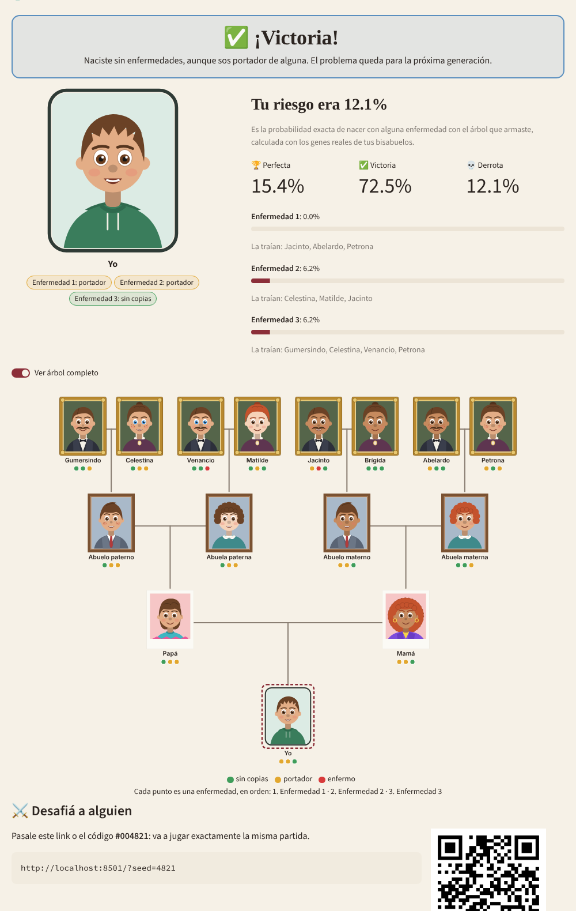

#  Bloodline

**Pick your great-grandparents wisely.** An educational game about Mendelian inheritance: hidden carriers, multinomial simulation and a bit of bad luck.

You choose 8 great-grandparents from a pool of 20 candidates and decide who marries whom. Grandparents, parents and finally *you* are born at random. If you are born free of the 3 hereditary diseases, you win. The catch: carriers look perfectly healthy.

Built for the *Trabajo Práctico clase 4: Funciones de distribución* (UNQ). The UI is in Spanish and English; the code is in English.



## How to play

1. Look at the candidates and the clue about their family. You don't know who is a carrier or who is sick.
2. Use your 4 free genetic tests: each one reveals a candidate's genotype for one disease.
3. Tap each frame of the tree to choose who goes there (each couple is a man and a woman).
4. Press **Be born!**

| Outcome | Condition |
|---|---|
| 🏆 Perfect win | No disease and no copies of any disease allele |
| ✅ Win | Healthy, but a carrier of at least one disease |
| 💀 Loss | Affected by at least one disease |

At the end the game shows your **risk**: the exact probability of being born sick with the tree you built. Full rules in Spanish: [`docs/reglas.md`](docs/reglas.md).

The game has a light and a dark theme. It follows the visitor's system setting and can be switched from the ⋮ menu (System / Light / Dark); the palettes live in [`.streamlit/config.toml`](.streamlit/config.toml) and the custom colors in `app.py` follow them through CSS `light-dark()`.

Every game has a **game code** (its random seed). Share the link `…/?seed=4821` and your friend plays exactly the same game.

## Why the multinomial distribution

For every gene a person carries 0, 1 or 2 copies of the recessive allele (AA, Aa, aa). For diseases the recessive allele is the disease allele: 0 = clear, 1 = healthy carrier, 2 = affected.

* **Founders.** The great-grandparents come from a population in Hardy-Weinberg equilibrium, so each genotype is a draw from Multinomial(1; p², 2pq, q²), where q is the allele frequency.
* **Children.** Each parent passes one of its two copies at random. With the transmission matrix

  ```
  T = [[1,   0  ],    # AA always passes A
       [0.5, 0.5],    # Aa passes A or a with a fair coin
       [0,   1  ]]    # aa always passes a
  ```

  a parent's gamete vector is `g = P_parent @ T`, and the child's genotype probabilities come from the outer product `outer(g_mother, g_father)` (the Punnett square) collapsed into (AA, Aa, aa). The child's genotype is again Multinomial.
* **Exact risk.** Propagating those vectors from the 8 great-grandparents down to "me" gives the exact probability of every outcome. The game shows it at the end, and the validation notebook compares it with Monte Carlo simulations.

## Validation

[`notebooks/validation.ipynb`](notebooks/validation.ipynb) imports the same `bloodline` package the app uses and checks:

1. Founders vs Hardy-Weinberg: chi-square test plus mean (2q) and variance (2pq).
2. Aa × Aa crosses vs Mendel's 1:2:1.
3. A full game pedigree: 20,000 simulated births vs the exact probabilities, and convergence of the estimated risk.
4. Calibration: QQ-plot of 1,000 chi-square p-values against Uniform(0, 1) and a KS test.
5. Detecting problems: a biased model (segregation distortion) is rejected, with a power curve by sample size.
6. Reproducibility with seeds.

The notebook is generated from [`notebooks/build_validation_notebook.py`](notebooks/build_validation_notebook.py). To rebuild and run it:

```bash
uv run python notebooks/build_validation_notebook.py
uv run jupyter nbconvert --to notebook --execute --inplace notebooks/validation.ipynb
```

## Running locally

With [uv](https://docs.astral.sh/uv/):

```bash
uv sync                      # creates .venv with app + dev dependencies
uv run streamlit run app.py  # opens http://localhost:8501
uv run pytest                # tests
```

Without uv: `pip install -r requirements.txt` (app only) or also `-r requirements-dev.txt` (tests and notebook).

`requirements.txt` is generated from `pyproject.toml` (Streamlit Community Cloud reads it). After changing dependencies:

```bash
uv lock
uv export --no-dev --no-hashes --no-emit-project -o requirements.txt
uv export --only-group dev --no-hashes --no-emit-project -o requirements-dev.txt
```

## Configuration and secrets

Settings are read from environment variables (a local `.env` is loaded automatically) and then from Streamlit secrets. Copy [`.env.example`](.env.example) to `.env`; the defaults work out of the box.

| Key | Default | What it does |
|---|---|---|
| `BLOODLINE_PUBLIC_URL` | `http://localhost:8501` | Public address, used for the share QR and challenge links |
| `BLOODLINE_REPO_URL` | this repo | Opened by the "Source code" menu option |
| `BLOODLINE_STORAGE` | `csv` | Where finished games are stored: `csv` or `gsheets` |
| `BLOODLINE_CSV_PATH` | `.data/results.csv` | CSV file for local development |
| `GSHEETS_RESULTS_SPREADSHEET_ID` | | Google Sheet that stores the results (leaderboard) |
| `GSHEETS_RESULTS_WORKSHEET` | `results` | Tab inside that sheet (created if missing) |
| `GOOGLE_SERVICE_ACCOUNT_FILE` / `GOOGLE_SERVICE_ACCOUNT_JSON` | | Service account key, as a file path or as the JSON itself |

Never commit `.env` or `.streamlit/secrets.toml`: both are git-ignored. On Streamlit Community Cloud, paste the values into **App settings → Secrets** following [`.streamlit/secrets.toml.example`](.streamlit/secrets.toml.example).

### Google Sheets leaderboard

1. In Google Cloud, create a project, enable the **Google Sheets API** and create a **service account**. Download its JSON key.
2. Create an empty Google Sheet and share it as **Editor** with the service account's e-mail.
3. Set `BLOODLINE_STORAGE=gsheets`, the sheet id and the credentials.

The CSV store works for local play, but Streamlit Community Cloud wipes its disk on every restart, so use Google Sheets in production.

## Biology data

Disease names, allele frequencies, cosmetic genes, names and fun facts live in [`data/config.json`](data/config.json). They are edited in a spreadsheet (guide in Spanish: [`docs/planilla.md`](docs/planilla.md)):

```bash
python scripts/sheet_sync.py export --xlsx bloodline_data.xlsx    # config.json -> spreadsheet
python scripts/sheet_sync.py import --sheet-id <GOOGLE_SHEET_ID>   # public Google Sheet -> config.json
python scripts/sheet_sync.py import --xlsx bloodline_data.xlsx     # local Excel file -> config.json
```

The import validates the data before overwriting `config.json`.

## Project structure

```
app.py                     Streamlit UI (screens: menu, build, result, leaderboard)
bloodline/
  config.py                loads and validates data/config.json
  genetics/base.py         InheritanceModel interface (plug in new models here)
  genetics/mendelian.py    Multinomial / Mendelian model and exact probabilities
  people.py                candidates, family clues
  game.py                  one game: slots, tests, births, outcome (no UI code)
  avatar.py                caricature portraits drawn as SVG, no AI or image files
  ui/                      SVG pedigree and HTML helpers
  i18n/                    es.json, en.json
  storage/                 CSV and Google Sheets result stores
  ranking.py               leaderboard
assets/                    logo (SVG) and favicon
data/config.json           biology parameters (generated from the spreadsheet)
notebooks/                 validation notebook
scripts/sheet_sync.py      spreadsheet <-> config.json
tests/                     pytest suite
docs/                      rules, spreadsheet guide and template
```

Randomness always goes through `numpy.random.default_rng`. The candidates of a game come from `default_rng([seed, 0])`, and the births from `default_rng([seed, 1, *founders])`, so the same seed and the same tree always produce the same child.

## Model limitations

* One gene per trait, two alleles, complete penetrance, no linkage and no new mutations.
* Eye and hair colour are simplified to one gene each. Skin tone is not genetic in V1: each child takes it from a random parent.
* The 8 great-grandparents are unrelated (no inbreeding).
* Allele frequencies are made up to keep the game challenging (≈50% risk for a random tree, ≈40% for a player who reads the clues); they don't describe real diseases.

## Roadmap (V2 ideas)

Contributions welcome. Some ideas we didn't get to:

* **Second game mode with complex diseases** (diabetes-like): a liability-threshold model with risk factors drawn from a **multivariate normal** distribution with correlations. The game only talks to the `InheritanceModel` interface, so a new model can be plugged in without touching the UI.
* **Real-time PvP**: two players drafting candidates in turns. `Game` has no UI code, so it can be shared between players.
* **Incomplete penetrance**: having aa gives a probability of getting sick, not certainty.
* Dominant and X-linked diseases.
* Polygenic skin tone.
* More kinds of family clues.

## License

[GPL-3.0](LICENSE).
